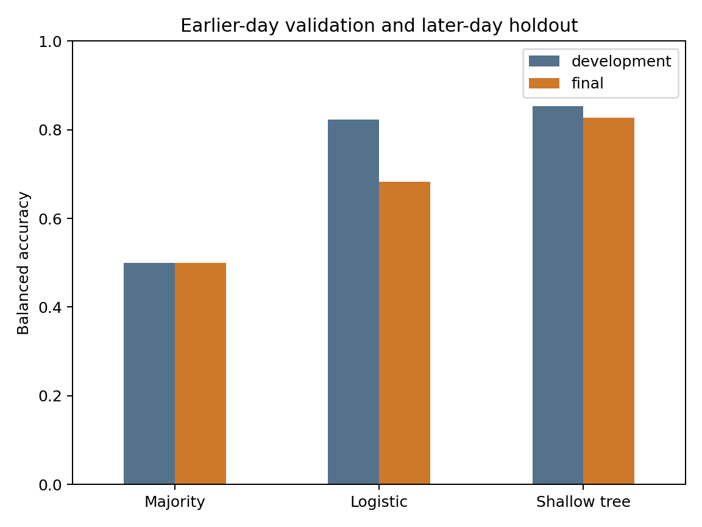
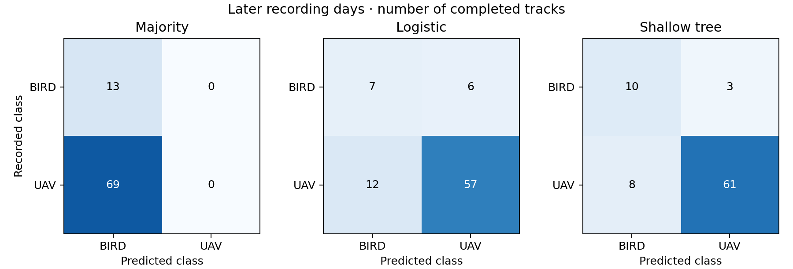

# Can a completed radar track distinguish a bird from a UAV?

Team 20 used the NRC Canada / University of Ottawa field measurements to test whether recorded motion and radar returns distinguish two observed classes. The older simulation supplies no training or evaluation examples. The unit of analysis is one completed system track.

## Measurements and evaluation

The pinned NRC snapshot provided 367,112 observations across 713 labeled tracks, 51 recording sessions and nine days. The pipeline reconciled annotations with metadata, suppressed 15 repeated representations and excluded ambiguous, mixed, unknown and unlabeled records. The four labels comprise 492 birds, 146 UAVs, 63 humans and 12 vehicles. Humans and vehicles each occurred on just three days. Only one day contained all four classes. We restricted the comparison to the 638 bird and UAV tracks.

For each track we used the mean and standard deviation of three velocity components and radar cross section (RCS). This eight-column allowlist excludes absolute position, observation counts, identity, provenance and radar classifications. A training-fold median fills missing values and training-fold statistics standardize inputs. Each fit uses the same fixed features. The two learned candidates use balanced class weights. A reference always predicts the development majority.

Five earlier days supplied 556 development tracks (479 birds, 77 UAVs). Each day served once as validation while the other days supplied training. We ranked the three fixed candidates by pooled out-of-fold balanced accuracy, with exact ties favoring simplicity. The last four days, starting December 18, 2020, supplied 82 final tracks (13 birds, 69 UAVs). Models were refitted on all five development days before scoring the holdout. The protocol used day and label coverage to define the task before training. No hyperparameter search was performed.

| Model | Development balanced accuracy | Final accuracy | Final balanced accuracy | Final macro F1 |
|---|---:|---:|---:|---:|
| Majority (bird) | 50.0% | 15.9% | 50.0% | 0.137 |
| Logistic regression | 82.3% | 78.0% | 68.2% | 0.651 |
| Depth-three tree | 85.4% | 86.6% | 82.7% | 0.781 |

The tree ranked first during development. On development days containing both classes its balanced accuracy ranged from 79.8% to 90.0%. The final tree correctly classified 10 of 13 birds and 61 of 69 UAVs. Of 18 tracks it called birds, eight were UAVs. Bird precision was 55.6%, recall 76.9% and F1 0.645. UAV precision was 95.3%, recall 88.4% and F1 0.917. Accuracy weights the 69 UAVs heavily. Balanced accuracy gives both class recalls equal weight.

## What the tree learned

The tree first divides tracks by how much their measured radar cross section varied. Subsequent decisions use average radar cross section or the mean velocity along the radar X axis. Each track follows at most three decisions to a class label. These splits describe associations in the development recordings. Radar orientation, missing returns, flight direction, object selection and recording conditions could all influence them. Ninety tracks in the full dataset lack RCS entirely. Median imputation can make missingness recognizable even without a missingness flag.

## What the evidence supports

- The tree exceeded both references on these four later days. Only two held-out days contained birds. Their balanced accuracies were 75.0% and 82.8%. Two UAV-only days support UAV recall alone.
- Four held-out days give little basis for a population confidence interval. Treating individual tracks as independent would overstate precision. Grouping by day protects related recordings, but the same physical object could recur on another day.
- These results apply to completed BIRD/UAV tracks from this field dataset. Four-class performance, intent, authorization, early warning and transfer to Kyle Field remain unvalidated.
- A further study needs independently collected days and sites, broader class coverage and documentation of repeated physical objects. The reported holdout is now public and future model revisions need fresh final data.

[Machine-readable model settings, confusion matrices, per-class metrics, day counts and exact standardized tree](phase2/evaluation.json)

Source measurements by Mehta, Bolic, Mantegh and Vidal, National Research Council Canada / University of Ottawa, under CC BY 4.0. Derived tables and figures summarize the pinned measurements. [NRC dataset](https://github.com/nrc-cnrc/CUAS-sensing-dataset/tree/df3cebae895f4f12d23cd50480dd4c47b09d422e)
